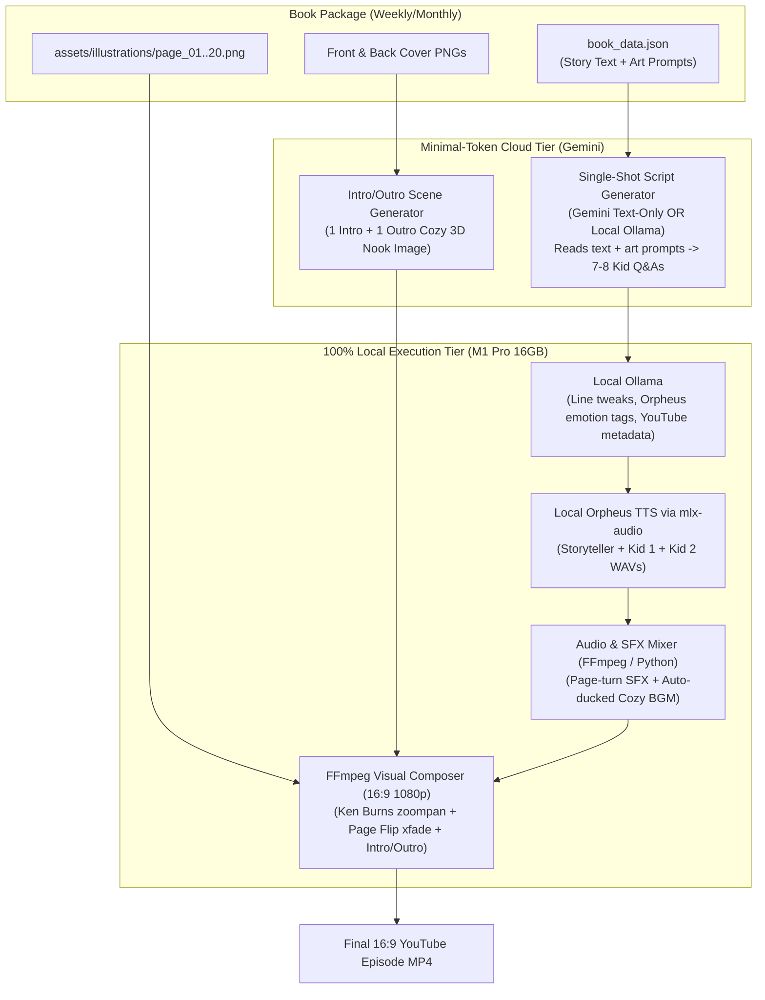

# Product Requirements Document (PRD): Kiddo Storytime Video Factory

**Project Name:** Kiddo Live Storytime Video Pipeline  
**Pilot Book:** *The Snail Mail Express: A Whisperwood Hollow Story* ([book_data.json](file:///Users/swiveltech/Disk/Swivel/kiddo/book_data.json))  
**Target Hardware (Local Node):** Apple Silicon Mac (M1 Pro, 16 GB Unified Memory)  
**Architecture Model:** Token-Efficient Hybrid Cloud (Gemini Single-Shot Script + Intro/Outro Keyframes) + 100% Local Audio & Video Engine (Ollama + `mlx-audio` Orpheus TTS + Python/FFmpeg)  
**Primary Output Format:** `16:9` Full YouTube Episode (1920×1080 MP4, extensible to `9:16` later)

---

## 1. Executive Summary & Vision

Build a repeatable, low-cost **Storybook-to-YouTube Video Factory** that transforms illustrated children's books into immersive, "simulated live" read-aloud videos for YouTube (`16:9`), designed to scale to weekly or monthly book releases.

### Finalized Creative & Technical Decisions
1. **Cast (3 Voices in Background):**
   * **Storyteller:** Warm, expressive narrator reading the story and answering the kids' questions.
   * **Kid 1 (Older Sibling, ~8yo):** Curious, observant, tries to guess plot mysteries.
   * **Kid 2 (Younger Sibling, ~5yo):** Playful, notices funny visual details (like mushrooms on Barnaby's foot), reacts with gasps and giggles.
2. **Voice Engine (`mlx-audio` + Orpheus TTS 3B):**
   * Runs locally on Apple Silicon M1 Pro via `mlx-audio` using **Orpheus TTS (`orpheus-3b-0.1-ft-4bit`)** to avoid robotic voices and support inline human vocalizations (`<giggle>`, `<laugh>`, `<chuckle>`, `<gasp>`, `<sigh>`, `<yawn>`).
3. **Token-Saver Intro & Outro Clips (Act I & Act III):**
   * **Visuals:** Stylized 3D / Cozy Storybook Animation (Pixar/gouache-inspired reading nook with the Storyteller + 2 Kids holding the current book's cover).
   * **Token Efficiency:** Generate **1 Intro keyframe image** and **1 Outro keyframe image** via Gemini (or composite the current book's cover onto a reusable reading-nook scene), then animate smooth camera push-in/pull-out, warm lighting effects, and Orpheus voice dialogue locally via **FFmpeg** (with the option to drop in a full Veo video clip anytime).
4. **distraction-Free Main Reading Stage (Act II):**
   * **No on-screen avatars or speech bubbles** during the story reading. The visuals focus 100% on the book pages and illustrations.
   * Voices (Storyteller + 2 Kids), cozy background music (auto-ducked when someone speaks), and sound effects (page turns, forest ambiance) play naturally in the background while **FFmpeg** animates the book pages (`zoompan` camera movements onto artwork details, page-flip `xfade` transitions, warm `16:9` storybook framing).
5. **Q&A Pacing & Zero-Vision-Token Scripting:**
   * Because [book_data.json](file:///Users/swiveltech/Disk/Swivel/kiddo/book_data.json) already includes detailed text `prompt` descriptions for all 20 illustrations alongside the story `text`, we require **zero expensive multimodal vision tokens**.
   * A **single-shot text prompt** to Gemini (or 100% local Ollama) generates the entire 20-page episode script in one pass (< \$0.01), placing natural Kid Q&A banter **every 2–3 pages** (~7–8 interruptions per book) so the story flows smoothly.

---

## 2. Hybrid System Architecture



---

## 3. Episode Structure (`16:9` YouTube Format — 1920×1080)

### Act I: Cozy Reading Nook Intro (0:00 – 0:08)
* **Visual:** Stylized 3D / gouache reading nook showing the Storyteller and the 2 Kids holding *The Snail Mail Express* ([The_Snail_Mail_Express_Front_Cover.png](file:///Users/swiveltech/Disk/Swivel/kiddo/build/The_Snail_Mail_Express_Front_Cover.png)). FFmpeg applies a smooth `zoompan` push-in toward the book cover with warm golden vignette lighting.
* **Audio (Orpheus TTS + Cozy Music):**
  * **Kid 2 (5yo):** *"<gasp> Look at that giant snail on the cover! He has a whole house on his back!"*
  * **Kid 1 (8yo):** *"It says 'The Snail Mail Express.' Do snails really deliver letters?"*
  * **Storyteller:** *"<chuckle> Let's open the book and find out together!"*
* **Transition:** Page-open transition (`xfade` + crisp paper flip SFX) into Page 1.

### Act II: The Book Reading & Background Q&A (0:08 – ~6:30)
* **16:9 Storybook Layout:**
  * A rich, warm parchment/woodland `16:9` widescreen canvas (`1920×1080`) created locally with Python (`Pillow`) + FFmpeg:
    * **Left / Center-Left (or Full-Focus):** High-resolution illustration (`page_XX.png`) with dynamic **FFmpeg `zoompan`** (slow Ken Burns pan/zoom during reading, and targeted zoom toward specific illustration regions during Kid Q&A).
    * **Right Side:** Open storybook page displaying the title and story typography on warm cream parchment, framed with golden trim matching [build/index.html](file:///Users/swiveltech/Disk/Swivel/kiddo/build/index.html).
* **Pacing Across 20 Pages:**
  * **Every Page:** Crisp page-flip transition (`xfade` `wipeleft` / `smoothleft` / curl effect) + `page_turn.wav` SFX, followed by the Storyteller reading the page text over gentle woodland ambiance and soft acoustic background music (`-26 dB`, auto-ducked).
  * **Every 2–3 Pages (~7–8 times total):** The kids chime in from the background before the page turns:
    * *Example (Page 1):* Kid 2 asks about the acorn mailbox and Barnaby's cottage shell; Storyteller chuckles and explains while FFmpeg smoothly zooms in on the illustration.
    * *Example (Page 4):* Kid 1 wonders who lost the three unaddressed mystery parcels (the silver dewdrop thimble, ticking acorn watch, and birch-bark melody).

### Act III: Reading Nook Outro & Subscribe CTA (Final 8 Seconds)
* **Transition:** Page closes to show [The_Snail_Mail_Express_Back_Cover.png](file:///Users/swiveltech/Disk/Swivel/kiddo/build/The_Snail_Mail_Express_Back_Cover.png), then crossfades to the Outro Nook scene with a gentle camera pull-back.
* **Audio:**
  * **Storyteller:** *"And that's the end of The Snail Mail Express! Which delivery was your favorite?"*
  * **Kid 2 (5yo):** *"<giggle> The birch-bark music roll! And the clover tea!"*
  * **Kid 1 (8yo):** *"I liked the ticking acorn watch. Can we read another story next week?"*
  * **Storyteller:** *"We sure can! Don't forget to subscribe and join us next time in Whisperwood Hollow!"*

---

## 4. Data Contracts & Multi-Book Folder Structure

### 4.1 Directory Structure
```text
kiddo/
├── PRD.md                           # This document
├── book_data.json                   # Pilot book data (The Snail Mail Express)
├── assets/
│   ├── illustrations/               # page_01.png .. page_20.png
│   └── audio_sfx/                   # Reusable page_turn.wav, cozy_bgm.mp3, forest_loop.wav
├── video_pipeline/
│   ├── generate_script.py           # Hybrid Gemini (single-shot) / Ollama script generator
│   ├── synthesize_voices.py         # Local mlx-audio Orpheus TTS runner (3 voices)
│   ├── compose_frames.py            # Renders 16:9 storybook spreads & zoom keyframes
│   ├── render_episode.py            # FFmpeg master pipeline (zoompan, xfade, audio ducking)
│   └── mcp_server.py                # MCP server exposing pipeline tools to Antigravity
└── episodes/
    └── the-snail-mail-express/
        ├── episode_script.json      # Generated dialogue, emotion tags & FFmpeg zoom targets
        ├── intro_nook.png           # Cozy 3D reading nook intro image
        ├── outro_nook.png           # Cozy 3D reading nook outro image
        ├── audio/                   # Per-turn WAV files + mixed page audio tracks
        └── output/
            ├── The_Snail_Mail_Express_YouTube_16x9.mp4
            └── youtube_metadata.md  # Generated title, description, timestamps & tags
```

### 4.2 `episode_script.json` Schema
```json
{
  "book_slug": "the-snail-mail-express",
  "title": "The Snail Mail Express",
  "aspect_ratio": "16:9",
  "resolution": [1920, 1080],
  "cast": {
    "storyteller": {
      "name": "Storyteller",
      "engine": "orpheus",
      "voice": "tara",
      "description": "Warm, soothing adult storyteller"
    },
    "kid_older": {
      "name": "Leo (Age 8)",
      "engine": "orpheus",
      "voice": "leo",
      "description": "Curious 8-year-old who loves solving mysteries"
    },
    "kid_younger": {
      "name": "Mia (Age 5)",
      "engine": "orpheus",
      "voice": "mia",
      "description": "Playful 5-year-old who notices cute visual details"
    }
  },
  "intro": {
    "image_prompt": "Stylized 3D Pixar and warm gouache illustration of a cozy woodland reading nook with a warm lamp, where a friendly storyteller and two kids (an 8-year-old boy and a 5-year-old girl) sit on a plush rug holding the hardcover book 'The Snail Mail Express'...",
    "ffmpeg_effect": "zoom_in_center",
    "lines": [
      { "speaker": "kid_younger", "text": "<gasp> Look at that giant golden snail! He has a tiny house on his shell!" },
      { "speaker": "kid_older", "text": "It says The Snail Mail Express! How can a slow snail deliver the mail?" },
      { "speaker": "storyteller", "text": "<chuckle> Let's open the book and see how Clara and Barnaby do it!" }
    ]
  },
  "pages": [
    {
      "page_number": 1,
      "has_qa": true,
      "ffmpeg_camera": {
        "narration_motion": "slow_push_in",
        "qa_zoom_target": { "x": 0.55, "y": 0.45, "zoom": 1.3 }
      },
      "lines": [
        {
          "speaker": "storyteller",
          "role": "narration",
          "text": "Beneath the mossy roots of the Great Whisperwood Oak stood the smallest, slowest post office in the forest..."
        },
        {
          "speaker": "kid_younger",
          "role": "question",
          "text": "Wait! <giggle> Even their mailbox looks like a giant acorn!"
        },
        {
          "speaker": "storyteller",
          "role": "answer",
          "text": "<chuckle> It sure does, Mia! Everything in Whisperwood Hollow is built right into the forest."
        }
      ]
    }
  ],
  "outro": {
    "image_prompt": "Stylized 3D Pixar and warm gouache illustration of the same cozy reading nook, the book gently closed on their lap as the two kids smile and wave...",
    "ffmpeg_effect": "zoom_out_warm_fade",
    "lines": [
      { "speaker": "storyteller", "text": "And that's the story of The Snail Mail Express! Which mystery parcel was your favorite?" },
      { "speaker": "kid_younger", "text": "The birch-bark song! <giggle> Because the wind played music through it!" },
      { "speaker": "kid_older", "text": "I liked how slowing down helped them notice everyone who needed help. What are we reading next week?" },
      { "speaker": "storyteller", "text": "Another magical adventure! Subscribe so you don't miss our next storytime!" }
    ]
  }
}
```

---

## 5. Sequential Memory & Token Budget (M1 Pro 16 GB)

| Stage | Tool / Model | Cloud Tokens Used | Local RAM Used | Est. Run Time |
| :--- | :--- | :--- | :--- | :--- |
| **1. Episode Script** | Single-shot Gemini Text OR Local Ollama (`qwen2.5:7b`) | ~2,500 text tokens (< \$0.01) or **0** (local) | ~4.5 GB (if Ollama) | ~20–40 sec |
| **2. Intro/Outro Keyframes** | 2 Images (or local composite with Front/Back Cover) | 0–2 image calls | < 0.5 GB | ~15 sec |
| **3. 3-Voice Audio Synthesis** | `mlx-audio` + **Orpheus TTS 3B (4-bit)** | **0 tokens** | ~3.0 GB | ~2–3 min |
| **4. Audio & SFX Mastering** | FFmpeg (`sidechaincompress` BGM ducking + page SFX) | **0 tokens** | < 0.5 GB | ~10 sec |
| **5. 16:9 Video Rendering** | Python `Pillow` + FFmpeg (`zoompan`, `xfade`, H.264/AAC) | **0 tokens** | ~1.5 GB | ~1–2 min |

---

## 6. Implementation Plan (Step-by-Step)

1. **Phase 1 — Environment & Audio Assets Setup:**
   * Install `mlx-audio` (with Orpheus TTS support) into `.venv` and pull a lightweight local Ollama model (`qwen2.5:7b` or `llama3.2:3b`).
   * Generate/curate royalty-free cozy background music loop and crisp paper page-flip SFX in `assets/audio_sfx/`.
2. **Phase 2 — Hybrid Script Generator (`video_pipeline/generate_script.py`):**
   * Read [book_data.json](file:///Users/swiveltech/Disk/Swivel/kiddo/book_data.json) (`text` + `prompt` fields) and generate `episode_script.json` with Storyteller + 2 Kids (7–8 natural Q&As across the 20 pages + Orpheus emotion tags + FFmpeg zoom coordinates).
3. **Phase 3 — Local Orpheus Multi-Voice Synthesis (`video_pipeline/synthesize_voices.py`):**
   * Synthesize all dialogue lines for Storyteller, Kid 1 (8yo), and Kid 2 (5yo) via `mlx-audio` Orpheus TTS, and stitch per-page audio tracks with natural pauses and page-flip SFX.
4. **Phase 4 — 16:9 Visual Stage & FFmpeg Compositor (`video_pipeline/render_episode.py`):**
   * Compose the `16:9` widescreen storybook layouts, Intro/Outro reading nook scenes (with [The_Snail_Mail_Express_Front_Cover.png](file:///Users/swiveltech/Disk/Swivel/kiddo/build/The_Snail_Mail_Express_Front_Cover.png) and [The_Snail_Mail_Express_Back_Cover.png](file:///Users/swiveltech/Disk/Swivel/kiddo/build/The_Snail_Mail_Express_Back_Cover.png)), FFmpeg `zoompan` camera motions, `xfade` page transitions, and auto-ducked background music into the final 1080p MP4.
5. **Phase 5 — Reusable CLI & MCP Wrapper (`video_pipeline/mcp_server.py`):**
   * Provide a single CLI command and MCP server tool so future weekly/monthly books can be rendered with one command.
